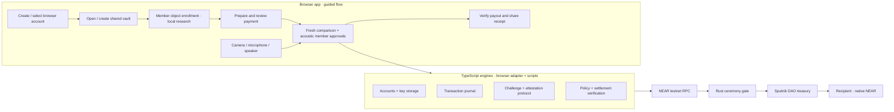

<div align="center">

# Accoryn

### Shared money. Explicit approval. Verifiable settlement.

A mobile and desktop web prototype for teams approving NEAR treasury payments together.


[Quick start](#quick-start) · [Features](#features-and-current-status) · [Architecture](#how-it-is-built) · [Contracts](#deployed-contracts) · [Test the flow](#test-the-flow) · [Security](#security-and-trust-boundaries)

</div>

---

Teams need a shared answer to three questions before money moves: **What are we paying? Who approved it? Did it actually settle?** Accoryn explores a meeting-based approval ceremony: a device broadcasts a fresh sound challenge, eligible vault members receive it and explicitly attest, and an on-chain gate checks the required approvals before voting on the payment.

The browser also provides a personal-object enrollment experiment, device checks and invoice preparation. Only built-in cameras, microphones and speakers are needed. No external tags, readers or security keys.

> [!IMPORTANT]
> **Guided-flow branch:** on `feat/near-tooling-testnet-rate-limit`, `/` and `/treasury/` now start with **Account → Vault → Member object → Payment → Approvals → Activity**. Each member enrolls locally for their own vault/account and compares a fresh scan before an app approval. The scan is an uncalibrated research checkpoint, not authentication or an on-chain object requirement. See the [exact two-device manual guide](docs/testing/2026-11-14-guided-vault-flow.md). The older `/workspace/` remains a compatibility draft editor. Payments currently support **native NEAR on testnet**, not USDC, other stablecoins or mainnet assets.

## Features and current status

| Feature | What you can do on `main` | Status |
|---|---|---|
| Device readiness | Preview/capture from the camera, measure microphone input, play and confirm a speaker tone | Browser feature |
| Personal-object enrollment | Capture three views, review/retake them, save a versioned local visual template | Browser research feature |
| Fresh object comparison | Compare a new capture with the template; inspect three cosine scores, top-two mean and inference time | Demo Match above 0.50; uncalibrated identity score |
| Invoice preparation | Enter recipient, treasury, purpose, date and line items; calculate exact NEAR totals; save and review local drafts | Browser feature |
| Connected treasury | Create/select accounts, create/load/fund vaults, save/submit invoices, host/listen, approve, execute, verify receipts and export CSV | Real browser/testnet integration; writes opt-in |
| Public board | Inspect vault policy and verified payout evidence without a local signing key | Read-only `/board/?dao=…`; latest 50 proposals |
| Governance | Propose complete membership changes or disabling factory automatic upgrades; inspect and vote | Real transaction controls; extended live acceptance pending |
| Legacy workspace | Prepare local drafts and inspect the old v1 service sections | Blockchain actions unavailable here; use `/treasury/` |
| Acoustic exchange | Broadcast/listen to a fresh challenge, compare check codes and record decoding trials | Browser lab; two-device acceptance pending |
| App-made accounts | Generate/store signing keys and create testnet accounts through the account helper | Connected UI + engine |
| Treasury engine | Build gated Sputnik policies, create DAOs and verify policy conformance | Connected UI + engine + live scripts |
| Ceremony gate | Bind approvals to a proposal/session and enforce cumulative-spend tiers | Deployed on testnet |
| Transaction journal | Reconcile transaction outcomes and guard against duplicate submission | Engine + opt-in live tests |
| Settlement verification | Verify proposal approval and an exact successful transfer receipt | Engine + recorded live evidence |

The demo reports **Match** when the mean of the two highest similarities exceeds **0.50**, and **No match** otherwise. No-match scans cannot continue to the object-check approval step. An image similarity score is not an identity probability or a private key; the demo cutoff is not calibrated authentication.

## How it is built



### Application stack

| Layer | Implementation | Why it is here |
|---|---|---|
| Interface | React 19, TypeScript, Vite 8, Tailwind CSS 4 | Responsive browser screens and typed feature boundaries |
| Object inference | Transformers.js 4.3.2, quantized DINOv2-small ViT-S/14, ONNX Runtime WASM in a worker | Local image embeddings without uploading camera frames |
| Local storage | IndexedDB and browser storage | Visual templates, engine keys/journal and local workspace state, with separate lifecycles |
| Sound modem | ggwave 0.4.0 + Web Audio | Audible/near-ultrasonic challenge transmission with device-dependent decoding |
| Ceremony crypto | `@noble/curves`, `@noble/hashes` | Domain-separated challenges, session keys and attendee-bound signatures |
| NEAR client | near-api-js 7.5.3 + JSON-RPC | Account creation, contract calls, reads and transaction reconciliation |
| On-chain enforcement | Rust + near-sdk 5.29 | Eligibility, session expiry, approvals, spend tiers and gate voting |
| Treasury | Existing Sputnik DAO v2 infrastructure | Holds funds, proposals and governance policy |
| Verification | Node test runner, Playwright/Chrome, Rust unit tests and NEAR sandbox | Numerical, lifecycle, browser, policy and settlement checks |

The baseline visual model produces **384-dimensional, L2-normalized embeddings**. Three enrolled views are stored locally; a fresh view is compared using cosine similarity. The model revision, artifact hashes, preprocessing and licenses are pinned in [the model manifest](web/src/object-registration/model-manifest.json). Preparation downloads approximately 24.5 MB of model weights plus the WASM runtime and verifies the expected assets. Model preparation contains no personal photos.

### Payment protocol

The implemented engine/contract workflow is:

1. **Propose:** a member creates a native-NEAR transfer proposal in the DAO, identifying the recipient, amount and purpose.
2. **Open:** the host generates a fresh 120-bit challenge and opens a gate session. Only its derived public key goes on-chain. Session TTL is bounded to 60–600 seconds; opening requires a 0.1 NEAR storage deposit.
3. **Receive and review:** a listener decodes the 20-character sound frame and checks the derived session key against chain state. The recipient and exact amount must be reviewed before approval.
4. **Attest:** each approving member signs and submits an account-bound attestation. Hearing sound alone does not authorize payment.
5. **Execute:** the gate checks membership, session state and the required cumulative-spend tier, then casts the DAO's transfer approval vote.
6. **Verify:** settlement requires both an approved proposal and exactly one successful DAO-to-recipient transfer receipt for the exact amount. A submitted transaction alone is not a paid receipt.

Default approval tiers use **cumulative spend within the configured window**, rather than each payment in isolation:

| Cumulative spend including this payment | Required attendees |
|---|---|
| Up to 1 NEAR | 2 |
| Above 1, up to 10 NEAR | 3 |
| Above 10 NEAR | All members |

For policy-compatible DAOs, ordinary members cannot directly `VoteApprove` transfers; the gate holds that permission. Governance has separate powers, described below.

## Deployed contracts

These addresses and hashes come from the [recorded testnet deployment and transaction evidence](docs/deployment/testnet.md), dated **2026-11-13**. They are test infrastructure, not production deployments.

| Component | Testnet account | Purpose |
|---|---|---|
| Ceremony gate v1 | [`ceremony-gate-v1.accoryn.testnet`](https://testnet.nearblocks.io/address/ceremony-gate-v1.accoryn.testnet) | Checks ceremonies and votes on eligible transfers |
| Sputnik factory | [`sputnikv2.testnet`](https://testnet.nearblocks.io/address/sputnikv2.testnet) | Existing infrastructure used to create DAOs |
| Spike treasury | [`accoryn-spike.sputnikv2.testnet`](https://testnet.nearblocks.io/address/accoryn-spike.sputnikv2.testnet) | Recorded protocol verification runs |
| Demo treasury | [`accoryn-demo.sputnikv2.testnet`](https://testnet.nearblocks.io/address/accoryn-demo.sputnikv2.testnet) | Additional gated treasury and payout demonstration |

<details>
<summary><strong>Deployment fingerprints and evidence</strong></summary>

- Gate code hash: `6RyhWz4BnSszxQg88ysQnECuFm2KWUXLUrdqVKtTcfBm`.
- Gate WASM size: 267,086 bytes in the deployment record.
- Factory-default DAO version: Sputnik v2.3.1.
- Factory-default DAO code hash: `AA4nA45vauiac3jdVwJTzSdUP3oj2r1fDaPAb2mHdgcH`.
- [Gate deployment transaction](https://testnet.nearblocks.io/txns/F3qKGJhfFcTtpCVQXvz6NNLet3ddPEcfB55zgszmaTGn).
- [Verified 0.05 NEAR ceremony payout](https://testnet.nearblocks.io/txns/4NKh8ik6P9a66RfDyUsaVNpbYSPVnBPmjNJwon2swzw5).
- [A member's rejected direct approval](https://testnet.nearblocks.io/txns/243Qb7wwWDtXN6yyAiq6g1fVUjjppLkSpRuCbQ8ACHfB): `ERR_PERMISSION_DENIED`.

The recorded build used Rust 1.93.0 and cargo-near 0.22.0. It was not a Docker-reproducible build; the recorded toolchain reproduced the deployed bytes. A different environment need not produce an identical hash.

**Upgrade status:** the deployment record retains a developer full-access key on the gate. Treat it as developer-controlled until key removal is independently verified. A planned lock is not evidence that it is already locked.

</details>

A connected browser run also created/funded `integration-bf7a0112.sputnikv2.testnet`, collected two account attestations and verified a [0.05 NEAR payout](https://testnet.nearblocks.io/txns/EA1nmm93YpiqBKy731Rc5Tba87nzrgZgpsqKUf8nCR5A). Its recognition step used labelled real-inference image fixtures and its audio used the laptop’s physical speaker/microphone. It was not two-device or live-camera acceptance. See the [connected acceptance guide](docs/testing/end-to-end-integration.md).

## Quick start

### Requirements

- **Node.js 22.18 or later** and npm.
- **Google Chrome** for the configured local browser automation; phone browsers need secure-context media access and manual acceptance.
- Internet for the initial pinned model download, and for NEAR testnet reads/writes.
- A camera, microphone and speaker for physical feature testing.

Running the browser features requires no wallet extension, Rust installation or NEAR credentials. Live-chain scripts and contract development have additional requirements below.

```sh
git clone https://github.com/anynomousfriend/Accoryn.git
cd Accoryn
npm ci --prefix web
VITE_ENABLE_TESTNET_WRITES=1 npm run dev --prefix web
```

The guided-flow changes are currently local to `feat/near-tooling-testnet-rate-limit`; use that branch in the existing development checkout. A fresh GitHub clone has the published main behavior until this feature is pushed or merged.

Open **http://127.0.0.1:5173/**. The first startup prepares the pinned vision assets; allow it to finish before testing.

For a phone on the same Wi-Fi:

```sh
VITE_ENABLE_TESTNET_WRITES=1 npm run dev:lan --prefix web
```

Use the printed **`https://<LAN-IP>:5173/`** address on both phone and laptop when sharing invitations. `https://localhost:5173/` also opens on the laptop, but links containing localhost cannot open on another device and its local account storage is separate. Accept/trust the local development certificate. Keep the laptop running and allow local-network access through its firewall. Phone camera/microphone access needs HTTPS; a plain LAN HTTP URL is insufficient.

`VITE_ENABLE_TESTNET_WRITES=1` explicitly enables real testnet transactions. Without it, signing actions stay unavailable and read-only access remains available. This flag is public configuration, never a place for secrets. See [`web/.env.example`](web/.env.example); restart Vite after changing it.

### Route guide

| Route | Purpose |
|---|---|
| `/` or `/treasury/` | Guided account, vault, member object, payment, approval and receipt workspace |
| `/device-check/` | Optional camera, microphone and speaker diagnostics |
| `/object-registration/` | Register, compare, replace or delete a local visual template |
| `/treasury/` | Connected account → vault → invoice → member ceremony → verified settlement |
| `/board/?dao=YOUR_VAULT` | Shareable read-only policy and verified payouts without a signing key |
| `/workspace/` | Legacy local invoice editor; follow its connected-treasury link for chain actions |
| `/acoustic-check/` | Run physical sound transmission trials |
| `/landing/` | Product concept landing page |
| `/design/` | Existing interface reference page |

Use the same origin throughout a local session: `localhost`, `127.0.0.1` and the LAN address have separate browser storage. Clearing site data removes that origin's local records.

## Test the flow

### 1. Open the guided workspace

Start at `/`, read the browser-key notice and choose **Start browser session**. Create a testnet username or select a locally stored account. You then move to **Vault**. Account creation no longer depends on a global object template.

Use **Create a vault → Name → Members → Review**. The selected creator is included automatically; add a partner’s full `name.testnet` ID and review the **6 NEAR** creation attachment. Share the public member invitation link so the partner opens the same vault with their own account.

The local demo server shares public account IDs across devices: after each person creates or selects their own account, vault members can be ticked in a list and payment recipients selected from a dropdown. Use **Refresh demo users** if needed. Signing keys stay on their original device. [Picker test steps](docs/testing/2026-11-14-demo-user-picker.md). Static builds retain optional manual ID entry.

### 2. Member object → payment → receipt

On each device open **Member object**, capture and accept three views, name the object and save the local template. Each enrollment is scoped to that exact member/vault/browser; no remote enrollment status or cross-device recovery is claimed.

Fund the vault, then open **Payment → New invoice**. Select the recipient, enter purpose and amount (try **0.05 testnet NEAR**), save, review and explicitly submit. The loaded vault is carried forward. Optional invoice reference/date and itemized editing remain available.

In **Approvals**, open the host’s five-minute session (**0.1 testnet NEAR** attachment). Each member compares a fresh scan. A **Match** above 0.50 enables **I reviewed this matched scan → Use matched scan for this payment**; **No match** blocks continuation. The local research check lasts at most two minutes and is bound to the exact payment/session/template. It does not prove same-object identity or protect an extracted browser key.

Listener taps **Listen to host sound**, then the host taps **Play host sound**. Each member explicitly consents and signs their own approval. Refresh the canonical payment; once the actual threshold is met, execute once. Publish verified payout evidence, open **Activity**, load receipts and share the keyless board. Approval alone is not settlement.

Follow the [full two-device checklist and failure cases](docs/testing/2026-11-14-guided-vault-flow.md). Camera permission, object discrimination and laptop-to-phone sound still need physical acceptance. **Settings** contains governance/recovery; the legacy `/workspace/` is not the recommended payment path.

**Account helper rate limits:** a 429 is the free faucet’s quota, not an image-model failure. Preserve the original account key/request, respect the cooldown, then reconcile/resume that same request. Do not rotate usernames/services to evade the quota or clear storage during an unknown outcome.

### 3. Standalone physical acoustic test: laptop ↔ phone

1. Start LAN HTTPS and open `/acoustic-check/` on both devices.
2. Keep both pages foregrounded, disable Bluetooth audio and start around 50–70% system volume. On iPhone, turn silent mode off.
3. Select **`audible-fast`** on both devices; begin with modem volume `25`.
4. On the receiving device, tap **Start listening** and allow microphone access. On the sender, tap **Start broadcast**.
5. **Expected:** the listener's **Heard check code** equals the broadcaster's **Check code**. Stop the broadcast before the next trial so it uses a fresh challenge.
6. Repeat in both directions, then in a noisier room. Record device/browser, successful trials, latency and any mismatch. Ultrasound is optional and hardware-dependent.

This lab does not submit a payment. Same-laptop physical loopback has recorded successful decoding; that does not establish phone/laptop reliability. Use the [two-device acceptance matrix](docs/testing/acoustic-check-manual.md) before claiming meeting readiness.

### 4. Scripted on-chain journey: create DAO → approve → pay → verify

This exercises the real engines and deployed contracts **through scripts**, as an alternative to the connected browser journey. The smoke script generates its challenge in-process; it does not listen through a microphone.

Use your own faucet-funded testnet accounts. The scripts read keys from `~/.near-credentials/testnet/`; never put credentials in this repository. A CLI installation is needed only for this section:

```sh
npm install -g near-cli-rs@0.31.1
```

Create four uniquely named accounts. Replace `yourname` below with your own prefix. The fourth account is a separate recipient so its balance delta is not reduced by execution gas:

```sh
for account in yourname-a yourname-b yourname-c yourname-payee; do
  near account create-account sponsor-by-faucet-service "$account.testnet" \
    autogenerate-new-keypair save-to-legacy-keychain network-config testnet create
done
```

Create a three-member gated treasury. Choose a fresh DAO name for each new treasury. The creator needs enough testnet NEAR for the **6 NEAR creation deposit, 1 NEAR extra funding by default, and gas**.

```sh
cd web
ACCORYN_CREATOR=yourname-a.testnet \
ACCORYN_MEMBERS=yourname-a.testnet,yourname-b.testnet,yourname-c.testnet \
ACCORYN_DAO_NAME=yourname-team \
node scripts/create-gated-dao-testnet.ts
```

**Expected:** a creation transaction, stored-policy conformance confirmation and a funding/balance report. The resulting DAO ID is `yourname-team.sputnikv2.testnet`.

Run the complete payout, still from `web/`:

```sh
ACCORYN_DAO=yourname-team.sputnikv2.testnet \
ACCORYN_HOST=yourname-a.testnet \
ACCORYN_ATTENDEES=yourname-a.testnet,yourname-b.testnet \
ACCORYN_EXECUTOR=yourname-c.testnet \
ACCORYN_PAYEE=yourname-payee.testnet \
node scripts/smoke-ceremony-testnet.ts
```

**Expected, in order:** proposal created → session opened → two attestations → gate vote → verified **0.05 NEAR** payout → evidence recorded → participation report. Open the printed explorer links and inspect the successful transfer receipt. Re-running this smoke script intentionally creates another proposal/payment; it is not a retry command for an existing payment.

The deployed gate can be reused without installing Rust or deploying another contract. Detailed setup and journal tests: [engine test guide](docs/testing/context-two-local.md). Recorded transaction provenance: [testnet deployment record](docs/deployment/testnet.md).

## Automated verification

From the repository root:

```sh
npm run check --prefix web
```

Runs unit tests → TypeScript checks → Playwright browser tests → production build → production inference smoke. Local Playwright uses installed Chrome; ensure another app is not occupying port 5173. Live transaction tests are opt-in and skipped by default. The local main integration check passed: **195 unit tests and 66 browser tests**, plus type checking, production build and packaged inference smoke. Two live unit tests and one live browser spending test were explicitly skipped; this merge does not claim a fresh live payout or physical two-device acceptance.

Individual checks are available when diagnosing a failure:

```sh
npm test --prefix web
npm run typecheck --prefix web
npm run test:browser --prefix web
npm run build --prefix web
npm run test:production --prefix web
```

For contract development, install Rust/rustup. The contract directory pins **Rust 1.93.0**, Clippy and `wasm32-unknown-unknown`. Install the recorded build CLI, then test against hash-checked Sputnik WASM:

```sh
cargo install --locked cargo-near@0.22.0
cd contracts/ceremony-gate
./scripts/fetch-sputnik-wasm.sh
cargo test
cargo clippy --all-targets -- -D warnings
cargo near build non-reproducible-wasm
```

The sandbox tests use a local NEAR node and the actual fetched DAO code. Building is not deploying. Keep fetched binaries and build output out of Git.

For opt-in transaction-journal tests, from `web/`, using your own keychain accounts:

```sh
ACCORYN_LIVE_TESTNET=1 \
ACCORYN_LIVE_SENDER=yourname-b.testnet \
ACCORYN_LIVE_PAYEE=yourname-payee.testnet \
node --test tests/near-live-testnet.test.ts
```

**Coverage boundary:** software audio round-trips, recorded chain fixtures and licensed image fixtures cannot prove physical microphone performance, same-object recognition under real capture variation or a secure human-presence guarantee. Those need explicit manual results; neither a fake media stream nor a fixture score is physical-device acceptance.

## Security and trust boundaries

| Boundary | What to understand |
|---|---|
| Object images | Observable and reproducible; they are not cryptographic secrets. The user-selected 0.50 demo cutoff is uncalibrated and does not establish identity. |
| Key custody | The connected account engine stores extractable, unencrypted signing material in browser IndexedDB. A compromised browser/profile can bypass UI restrictions. No object-based cross-device key recovery exists. |
| Acoustic presence | Sound demonstrates communication between devices. Live relay, collusion and one person controlling several member accounts remain possible. |
| Approval | Challenge receipt is separate from explicit member consent. Eligibility and account-bound attestations are checked by the protocol/gate. |
| Governance | `G = max(2, N−1)` members can change policy, replace members or remove the gate. Governance can authorize fund movement outside the ceremony; no timelock is implemented. |
| Factory updates | A DAO with `auto_update: true` trusts the Sputnik factory owner's update power. Disabling it requires the appropriate governance proposal. |
| Gate upgrades | The recorded deployment remains developer-controlled until its full-access key is demonstrably removed. |
| Privacy | Personal camera frames stay in the baseline browser flow. On-chain recipients, amounts, proposal descriptions and invoice references are public. Do not put confidential invoice contents on-chain. |

This is a research prototype, not an audited production wallet. See the [protocol and threat model](docs/security/ceremony-threat-model.md) for replay handling, spend tiers, policy escape hatches and failure semantics.

## NEAR agent tooling

The project includes an isolated official NEAR MCP adapter for read-only testnet account/contract inspection, plus locally installed official NEAR development skills. See [tool setup, verification and faucet recovery](docs/testing/near-tooling-and-testnet.md). MCP does not bypass the free account faucet’s limits or replace the browser signing flow.

## Troubleshooting

| Symptom | Check |
|---|---|
| Camera/microphone unavailable on phone | Use LAN HTTPS, trust the certificate and allow browser/OS media permissions. |
| Phone cannot reach the app | Same Wi-Fi, printed LAN URL, laptop awake, firewall/network access; a VPN or isolated guest network may interfere. |
| First model load is slow or fails | Finish asset preparation; check internet, free storage and console errors. Retry explicitly. |
| Pen/bottle or similar objects score unexpectedly | Record the images/conditions privately and report the scores. Similarity is not a secure identity verdict. |
| Sound is not decoded | Use matching audible modes, foreground pages, built-in audio, then adjust distance/volume. Do not assume ultrasound support. |
| Chain action is disabled | Use `/treasury/`, start Vite with `VITE_ENABLE_TESTNET_WRITES=1`, and start a browser session. Member approvals also require the payment-bound object research check. `/workspace/` retains its unavailable v1 bindings. |
| Account helper returns HTTP 429 | Keep the original pending request/key, reconcile and resume later; do not clear storage or create a replacement intent. |
| A write is pending/unknown after reload | Reconcile the original request; do not submit a second payment to guess whether the first succeeded. |
| `npm ci` reports missing optional `@emnapi` entries | See the [documented lockfile pitfall](docs/integration/context-two-engines.md#pitfalls-already-hit); preserve the committed lockfile. |
| Live script cannot find a key | Ensure your own account was saved to the testnet legacy keychain and all account environment variables are set. |
| DAO creation fails or name already exists | Use a new name and confirm the creator's testnet balance covers deposit, funding and gas. |
| Tests connect to an unexpected app | Stop the unrelated service on port 5173 before running this branch's browser suite. |

## Repository map

```text
web/
  src/
    object-registration/   Camera lifecycle, worker inference and local templates
    acoustic-check/        Browser sound-exchange lab
    workspace/             Invoice drafts, review and app sections
    integration/           Legacy v1 service boundary; unavailable workspace bindings
    engines/
      app/                 Connected UI, real adapter, public board and operation recovery
      acoustic/            ggwave modem and audio session lifecycle
      ceremony/            Domain-separated challenge/signature protocol
      near/                Accounts, custody, DAO policy, journal and settlement
    design/                Shared tokens and interface primitives
  scripts/                 Asset preparation, production smoke and live testnet tools
  tests/                   Unit/browser suites and provenance-labelled fixtures
contracts/ceremony-gate/    Rust contract, protocol vectors and sandbox tests
docs/                      Deployment evidence, manual testing and integration guides
```

| Read next | Purpose |
|---|---|
| [Context 1](CONTEXT_1.md) / [Context 2](CONTEXT_2.md) | Work ownership and implementation checkpoints; historical entries retain their dates |
| [Connected acceptance guide](docs/testing/end-to-end-integration.md) | Browser payment journey, recovery and evidence limits |
| [Engine integration guide](docs/integration/context-two-engines.md) | Engine APIs and original adapter handoff |
| [App adapter contract](docs/integration/context-one-adapter.md) | Typed UI/service boundary |
| [Deployment record](docs/deployment/testnet.md) | Contract fingerprints and transaction evidence |
| [Manual engine guide](docs/testing/context-two-local.md) | Reproduce contract and live-chain checks |
| [Acoustic checklist](docs/testing/acoustic-check-manual.md) | Physical-device trial matrix |
| [Hackathon alignment](docs/hackathon/track-alignment.md) | Track rationale and evidence requirements |
| [Working agreement](AGENTS.md) | Feature acceptance, privacy and Git conventions |

## Contributing and attribution

Keep changes cohesive and reviewable. Use feature branches and reviewed pull requests, meaningful failing tests before behavior changes, and exact manual acceptance steps at feature handoff. Do not commit signing keys, raw captures, certificates, environment secrets, dependencies, model weights or generated build/test output. See [AGENTS.md](AGENTS.md).

Built with React, Vite, Tailwind CSS, Transformers.js, DINOv2, ONNX Runtime, ggwave, near-api-js, Noble cryptography and the NEAR Rust SDK/tooling. The Sputnik DAO factory and DAO contract are existing NEAR infrastructure. Model/runtime licenses and hashes are recorded in the manifest; library licenses remain with their respective packages. AI coding assistants, including Claude Code and Codex, assisted development.
